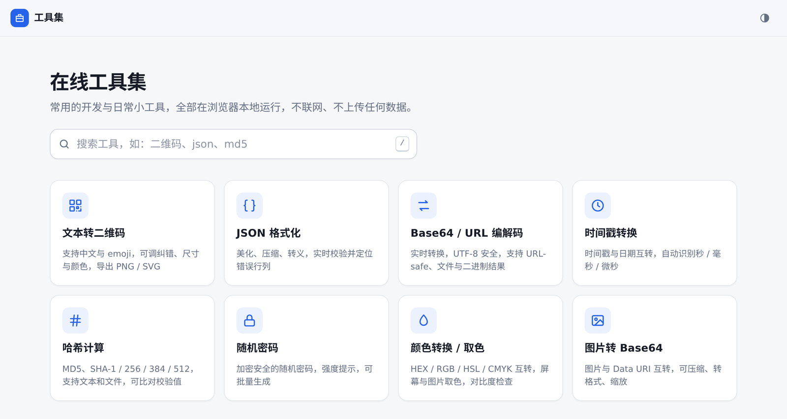
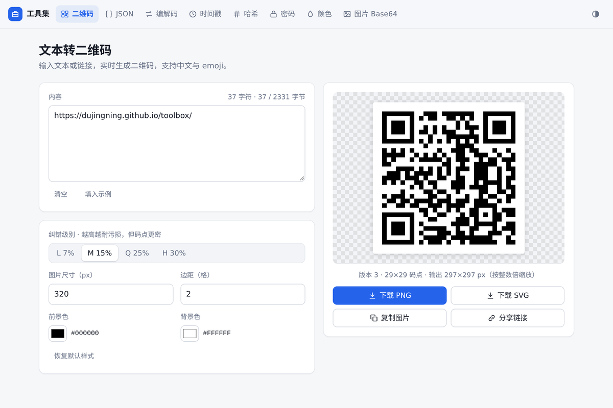
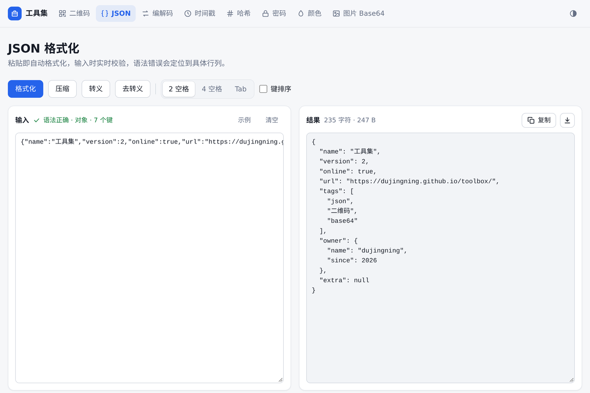
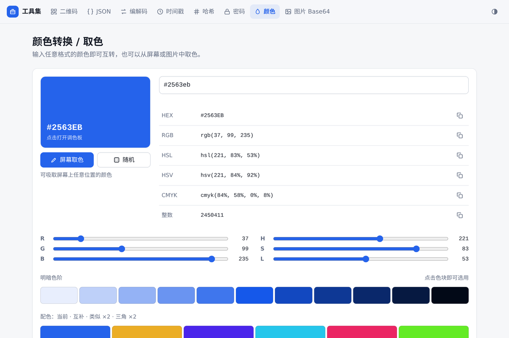

<div align="center">

<a href="https://dujingning.github.io/toolbox/"></a>

<h1>在线工具集</h1>

<p><b>开发者的离线瑞士军刀</b></p>

<p>二维码、JSON、Base64、时间戳、哈希、密码、颜色、图片转 Base64<br>8 个常用小工具，打开即用，数据不出浏览器。</p>

<h4>
  <a href="https://dujingning.github.io/toolbox/">在线使用</a> ·
  <a href="https://github.com/dujingning/toolbox/issues/new?template=new-tool.yml">建议新工具</a> ·
  <a href="https://github.com/dujingning/toolbox/issues/new?template=bug.yml">反馈问题</a> ·
  <a href="CONTRIBUTING.md">参与贡献</a>
</h4>

<p>
  <a href="https://dujingning.github.io/toolbox/"></a>
  <a href="LICENSE"></a>
  
  <a href="https://github.com/dujingning/toolbox/commits/main"></a>
  <a href="CONTRIBUTING.md"></a>
</p>

<a href="https://dujingning.github.io/toolbox/">
  <picture>
    <source media="(prefers-color-scheme: dark)" srcset="assets/screenshot-dark.png">
    
  </picture>
</a>

</div>

## ✨ 特点

- 🔒 **隐私优先**：没有后端、没有统计脚本，所有计算都在浏览器里完成，输入的内容不会离开你的设备。
- 📦 **零依赖**：不加载任何 CDN 或第三方资源，断网也能用。
- 🧩 **单文件**：每个工具都是一个自包含的 HTML 文件，可以单独拷走、发给同事或放进内网。
- ⚡ **即输即得**：输入时实时出结果，不用反复点按钮。
- 💾 **自动保存**：输入内容保存在本机浏览器，刷新页面也不会丢。
- 🌓 **深色模式**：默认跟随系统，也可以手动切换。
- 📱 **手机友好**：手机、平板上同样好用，图片取色支持触屏。

## 🧰 工具列表

**生成**

- [**文本转二维码**](https://dujingning.github.io/toolbox/tools/qrcode.html)：支持中文与 emoji，可调纠错级别、尺寸和颜色；导出 PNG / SVG，复制图片，生成分享链接。
- [**随机密码**](https://dujingning.github.io/toolbox/tools/password.html)：使用加密安全随机数，显示强度，可排除易混淆字符，支持批量生成。
- [**哈希计算**](https://dujingning.github.io/toolbox/tools/hash.html)：MD5、SHA-1 / 256 / 384 / 512，支持文本和文件，粘贴校验值自动比对。

**格式化与校验**

- [**JSON 格式化**](https://dujingning.github.io/toolbox/tools/json.html)：粘贴即格式化，实时校验，错误定位到行列并给出中文说明；支持压缩、键排序、转义。

**编码与转换**

- [**Base64 / URL 编解码**](https://dujingning.github.io/toolbox/tools/base64-url.html)：输入即转换，UTF-8 安全，支持 URL-safe 和文件编码；解码出二进制数据时可预览并下载。
- [**时间戳转换**](https://dujingning.github.io/toolbox/tools/timestamp.html)：时间戳与日期互转，自动识别秒 / 毫秒 / 微秒，支持中文日期和日期选择器。
- [**图片转 Base64**](https://dujingning.github.io/toolbox/tools/image-base64.html)：批量生成 Data URI / CSS / HTML / Markdown，可转格式、压缩、限宽，也能把 Base64 还原为图片。

**图像与颜色**

- [**颜色转换 / 取色**](https://dujingning.github.io/toolbox/tools/color.html)：HEX / RGB / HSL / HSV / CMYK 互转，屏幕吸管与图片取色，色阶配色，WCAG 对比度检查。

## 📸 截图

<table>
  <tr>
    <td width="33%" align="center">
      <picture>
        <source media="(prefers-color-scheme: dark)" srcset="assets/screenshot-qrcode-dark.png">
        
      </picture>
      <br><sub>文本转二维码</sub>
    </td>
    <td width="33%" align="center">
      <picture>
        <source media="(prefers-color-scheme: dark)" srcset="assets/screenshot-json-dark.png">
        
      </picture>
      <br><sub>JSON 格式化</sub>
    </td>
    <td width="33%" align="center">
      <picture>
        <source media="(prefers-color-scheme: dark)" srcset="assets/screenshot-color-dark.png">
        
      </picture>
      <br><sub>颜色转换 / 取色</sub>
    </td>
  </tr>
</table>

## 🚀 快速开始

### 在线使用

打开 <https://dujingning.github.io/toolbox/>，无需注册或安装。每个工具都有固定地址，可以直接收藏。

### 本地使用

```bash
git clone https://github.com/dujingning/toolbox.git
```

也可以在仓库页面点击 **Code → Download ZIP**。解压后用浏览器打开 `index.html` 即可，不需要安装或构建。只需要某个工具时，单独拷走 `tools/` 下对应的文件也能用。

### 自行部署

项目是纯静态文件，放到任意静态服务器上即可：

```bash
# 临时预览
python3 -m http.server 8080

# Docker（Nginx），只挂载页面文件，避免把 .git 等目录公开出去
docker run -d --name toolbox -p 8080:80 \
  -v "$PWD/index.html":/usr/share/nginx/html/index.html:ro \
  -v "$PWD/tools":/usr/share/nginx/html/tools:ro \
  nginx:alpine
```

想要自己的在线版本，可以 Fork 本仓库，然后在 **Settings → Pages** 中选择从 `main` 分支根目录部署。

## 🔗 链接直达

二维码工具支持通过链接参数直接生成，适合嵌入文档或分享：

```text
https://dujingning.github.io/toolbox/tools/qrcode.html?text=要生成的内容
```

页面上的「分享链接」按钮会自动生成这样的地址。

## 🌐 浏览器兼容

推荐使用最新版 Chrome、Edge、Firefox 或 Safari。以下功能依赖浏览器支持：

| 功能 | 说明 |
| --- | --- |
| 屏幕取色 | 使用 EyeDropper API，仅电脑版 Chrome / Edge 支持；其他浏览器可以用图片取色代替 |
| 复制图片到剪贴板 | 部分浏览器不支持，可以改用下载 |
| SHA 系列哈希 | 需要 Web Crypto，通过 HTTPS 或直接打开本地文件时都可以使用 |
| 自动保存 | 使用浏览器 localStorage，隐私模式下关闭窗口后不会保留 |

## 🛡️ 隐私与安全

- 页面不发起任何网络请求，也不包含统计、广告或第三方脚本，可以在浏览器开发者工具的「网络」面板中验证。
- 自动保存的内容只存放在你自己浏览器的 localStorage 中。处理敏感数据后，可以在浏览器设置中清除本站数据。
- 随机密码使用浏览器的 `crypto.getRandomValues` 生成，并通过拒绝采样避免取模偏差。

## 🤝 参与贡献

欢迎任何形式的贡献：

- 想要新工具：[提交新工具建议](https://github.com/dujingning/toolbox/issues/new?template=new-tool.yml)
- 发现问题：[反馈 Bug](https://github.com/dujingning/toolbox/issues/new?template=bug.yml)
- 改进代码：请先阅读 [贡献指南](CONTRIBUTING.md)，里面有目录结构、设计原则和新增工具的步骤

## 📄 许可证

[MIT](LICENSE) © 2026 dujingning
